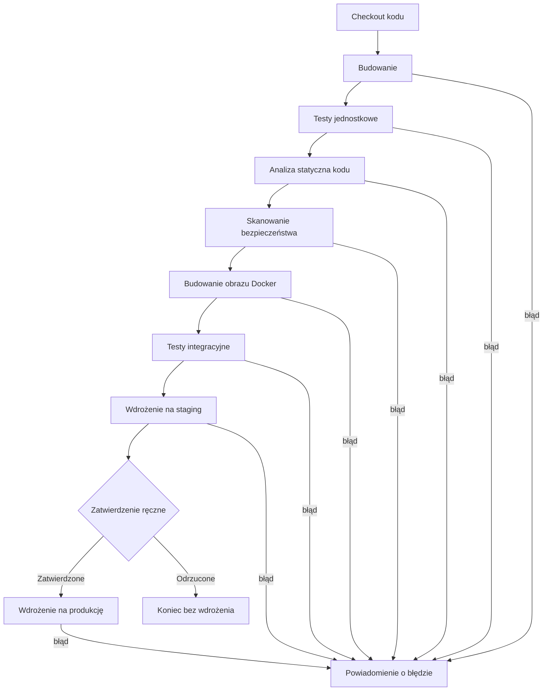

# Zadanie 27: Generowanie diagramu Mermaid dla potoku Jenkins

**Użyty asystent:** Claude (Claude Code)

## Prompt

```
Stwórz diagram Mermaid przedstawiający typowy pipeline CI/CD w Jenkinsie dla aplikacji webowej. Uwzględnij etapy: checkout kodu, budowanie, testowanie, analiza statyczna kodu, bezpieczeństwo, budowanie obrazu Docker, testy integracyjne, wdrożenie na środowisko staging i produkcja.
```

## Kod Mermaid

Zapisany w pliku [`jenkins-pipeline.md`](jenkins-pipeline.md).



**Uwaga:** nie mam dostępu do przeglądarki, więc nie wkleiłem kodu do Mermaid Live Editor i nie widziałem wyrenderowanego diagramu. Składnię napisałem zachowawczo (podstawowe węzły, strzałki, romb decyzyjny i etykiety krawędzi), a GitHub renderuje bloki `mermaid` w podglądzie pliku. Warto po wypchnięciu otworzyć plik na GitHubie i sprawdzić, czy diagram wyświetla się poprawnie.

## Zależności między etapami

Etapy układają się w **liniowy łańcuch bramek jakości**: każdy kolejny etap wykonuje się tylko wtedy, gdy poprzedni zakończył się sukcesem. Jeśli którykolwiek zawiedzie, pipeline się zatrzymuje, a zespół dostaje powiadomienie (strzałki z etykietą "błąd").

| Etap | Zależy od | Dlaczego w tym miejscu |
|---|---|---|
| **Checkout kodu** | brak | Punkt startowy. Pobiera kod z konkretnego commita, na którym pracują wszystkie kolejne etapy. |
| **Budowanie** | Checkout | Potrzebny jest kod źródłowy. Kompilacja lub instalacja zależności szybko ujawnia błędy składni. |
| **Testy jednostkowe** | Budowanie | Testują zbudowany kod. Są szybkie, więc stoją wcześnie (zasada fail fast). |
| **Analiza statyczna kodu** | Testy | Sprawdza jakość i styl kodu (np. SonarQube, ESLint). Nie wymaga uruchomienia aplikacji. Może też działać równolegle z testami. |
| **Skanowanie bezpieczeństwa** | Analiza | Szuka podatności w zależnościach i kodzie (np. `npm audit`, Trivy, OWASP Dependency-Check). Nie ma sensu pakować kodu z krytycznymi lukami do obrazu. |
| **Budowanie obrazu Docker** | Wszystkie powyższe | Obraz powstaje dopiero z kodu, który przeszedł testy, analizę i skan. Dzięki temu w rejestrze nie ląduje wadliwy artefakt. |
| **Testy integracyjne** | Obraz Docker | Sprawdzają współpracę komponentów (aplikacja z bazą, API), więc potrzebują uruchomionego obrazu. Są wolniejsze, dlatego stoją później. |
| **Wdrożenie na staging** | Testy integracyjne | Środowisko zbliżone do produkcji, na którym weryfikuje się ten sam obraz, który trafi do użytkowników. |
| **Zatwierdzenie ręczne** | Staging | Bramka decyzyjna. Człowiek sprawdza staging i zatwierdza lub odrzuca wdrożenie produkcyjne (w Jenkinsie krok `input`). |
| **Wdrożenie na produkcję** | Zatwierdzenie | Ostatni etap. Wdraża ten sam obraz, który przeszedł staging, bez ponownego budowania. |

## Wnioski

1. **Kolejność od najtańszych do najdroższych kontroli.** Szybkie testy jednostkowe i analiza są przed kosztownym budowaniem obrazu i testami integracyjnymi, żeby szybciej wykrywać błędy i oszczędzać czas agentów.
2. **Jeden artefakt na całej drodze.** Obraz zbudowany raz jest testowany, wdrażany na staging, a potem na produkcję. Dzięki temu produkcja dostaje dokładnie to, co zostało przetestowane.
3. **Bramki jakości** (testy, analiza, skan bezpieczeństwa) blokują dalszy przebieg, a ręczne zatwierdzenie chroni produkcję.
4. **Możliwa równoległość:** analiza statyczna i skanowanie bezpieczeństwa są niezależne od siebie i od testów, więc w Jenkinsie można je uruchomić w bloku `parallel`, skracając czas. Diagram pokazuje wariant sekwencyjny dla prostoty.
5. **Dodatek spoza listy zadania:** węzeł zatwierdzenia ręcznego i powiadomienie o błędzie dodałem jako typowe elementy, których w liście etapów nie było.
