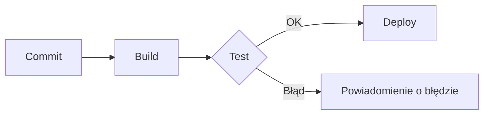

# Zadanie 6: Pierwszy diagram Mermaid

**Użyty asystent:** Claude (Claude Code)

## Prompt

```
Stwórz prosty diagram Mermaid pokazujący proces CI/CD: commit → build → test → deploy.
```

## Kod Mermaid


## Opis wygenerowanego diagramu

Diagram typu `flowchart LR` (od lewej do prawej) składa się z czterech prostokątnych węzłów połączonych strzałkami:

**Commit → Build → Test → Deploy**

- **Commit:** programista wysyła zmiany do repozytorium, co uruchamia pipeline.
- **Build:** budowanie aplikacji lub obrazu Docker.
- **Test:** uruchomienie testów automatycznych.
- **Deploy:** wdrożenie na środowisko.

**Uwaga:** nie mam dostępu do przeglądarki, więc nie wkleiłem kodu do Mermaid Live Editor ani nie zrobiłem zrzutu ekranu. Powyżej jest opis diagramu oparty na składni kodu. Blok `mermaid` renderuje się też bezpośrednio na GitHubie, więc diagram widać w podglądzie tego pliku.

## Wersja rozszerzona (dodatkowo)

Ta sama składnia z gałęzią w przypadku nieudanych testów:



## Wnioski

- Mermaid opisuje diagram tekstem, więc można go wersjonować w Git razem z kodem.
- `LR` oznacza układ poziomy (`TD` to układ pionowy), a `{}` tworzy węzeł decyzyjny (romb).
- GitHub renderuje bloki `mermaid` w plikach Markdown bez dodatkowych narzędzi.
